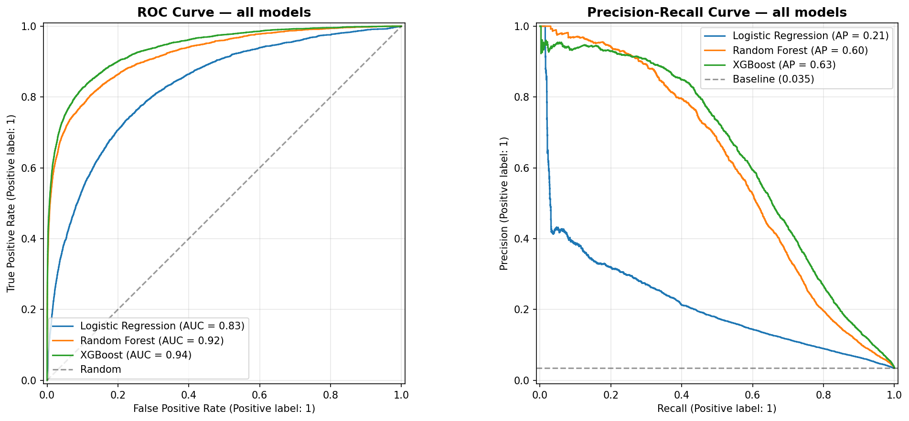
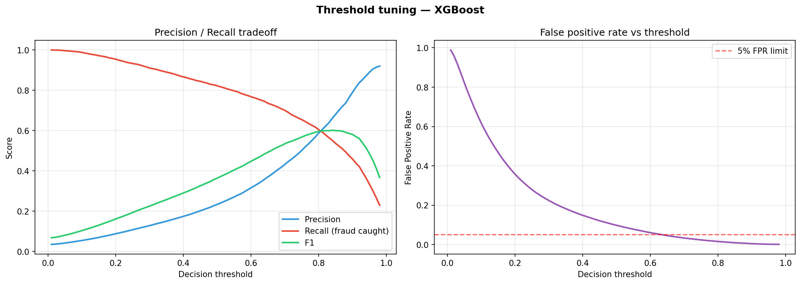
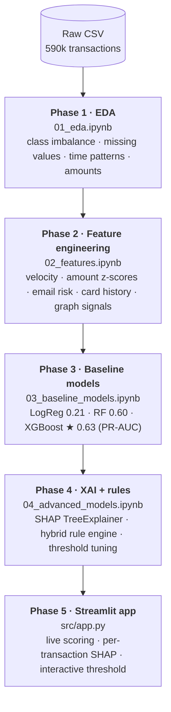
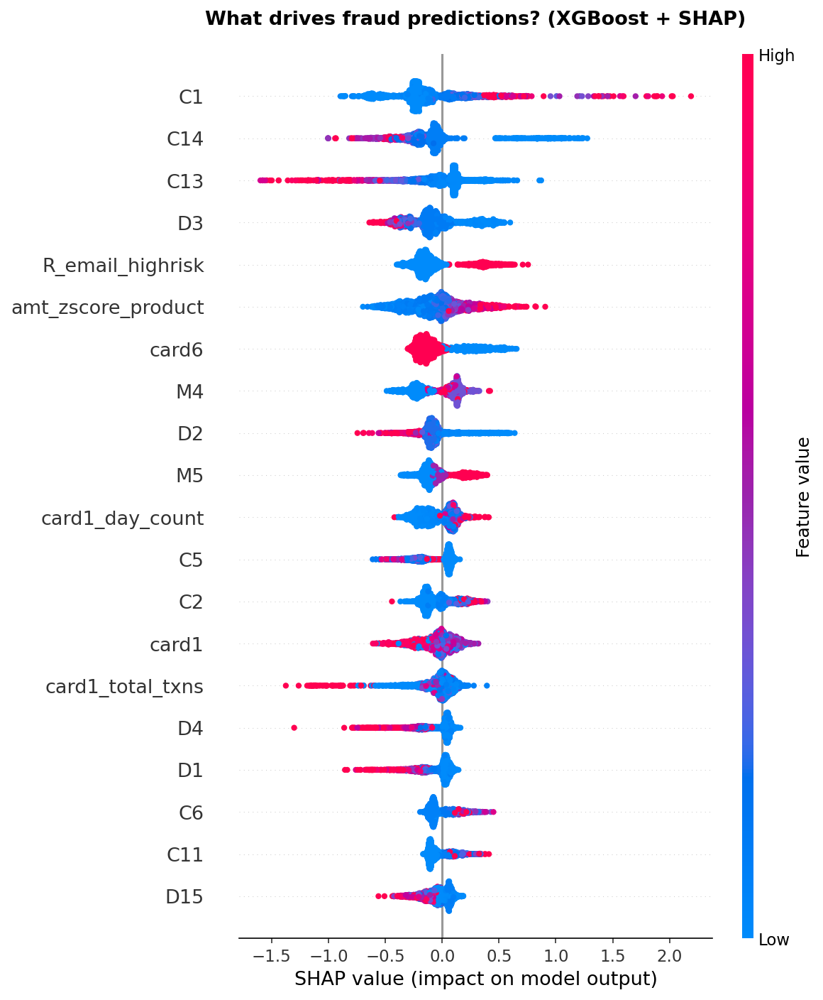
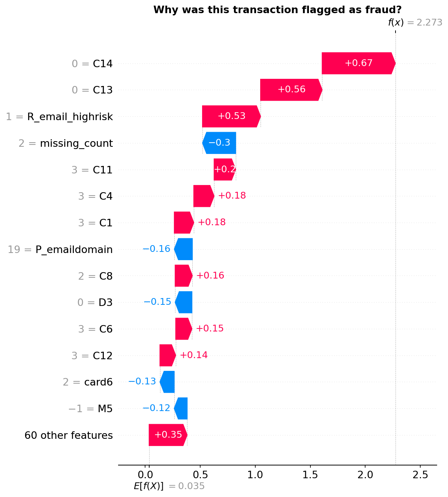
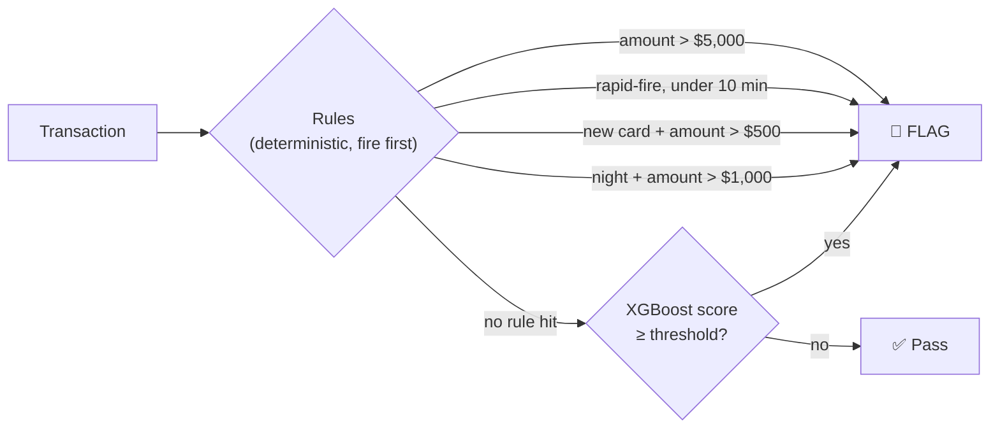

<div align="center">

# 🔍 Financial Fraud Detection System

### AML transaction monitoring with XGBoost, SHAP explanations and a hybrid rule engine


-success?style=flat-square)


</div>

---

## Overview

An end-to-end machine learning system for detecting fraudulent financial transactions, modelled on the architecture of the AML (Anti-Money Laundering) platforms banks and payment providers run in production.

It combines **rule-based detection** with **explainable gradient boosting**. Every model decision can be explained at the level of a single transaction with SHAP values, which AML compliance frameworks require.

### Results on IEEE-CIS (590,540 real transactions)

| Metric | Value |
|--------|-------|
| ROC-AUC | **0.938** |
| PR-AUC | **0.629** (18× above random baseline) |
| Fraud caught @ threshold 0.63 | 75.1% |
| False positive rate @ threshold 0.63 | 5.1% |
| Training set size | 472,432 transactions |
| Test set size | 118,108 transactions |

<table>
  <tr>
    <td width="50%"><p align="center"><sub>ROC and PR curves</sub></p></td>
    <td width="50%"><p align="center"><sub>Threshold tuning</sub></p></td>
  </tr>
</table>

## Architecture



## Feature engineering

40+ domain features engineered from raw transaction data.

<details open>
<summary><b>Feature groups</b></summary>

<br>

| Group | Features | Signal |
|---|---|---|
| **Time** | `hour`, `is_night` | Fraud spikes 2–4am, when cardholders are asleep |
| | `is_weekend`, `day_of_week` | Weekly behaviour shifts and fraud cycles |
| **Amount anomaly** | `log_amount` | Handles right-skewed distributions |
| | `amt_zscore_product` | Standard deviations from the product-type baseline |
| | `is_round_amount` | Fraudsters test cards with round numbers ($100, $500) |
| **Velocity** *(core AML signal)* | `card1_day_count` | Transactions per card in a rolling window |
| | `card1_time_since_last` | Hours since the previous transaction on this card |
| | `card1_rapid_fire` | Flag: < 10 min between transactions |
| **Identity risk** | `R_email_highrisk`, `P_email_highrisk` | Recipient / purchaser using disposable or free webmail |
| | `email_domain_match` | Purchaser and recipient domain mismatch |
| | `missing_count` | Number of missing key identity fields |
| **Card history** | `is_new_card` | First-ever use of this card |
| | `card1_total_txns` | Lifetime transaction count |
| | `card_type_fraud_rate` | Historical fraud rate by card network |

</details>

## Model selection

| Model | ROC-AUC | PR-AUC | Notes |
|-------|---------|--------|-------|
| Logistic Regression | 0.830 | 0.214 | Linear, misses complex patterns |
| Random Forest | 0.920 | 0.597 | Strong but slow at inference |
| **XGBoost ★** | **0.938** | **0.629** | Champion, best PR-AUC |

> [!IMPORTANT]
> **Why PR-AUC over ROC-AUC.** With 96.5% of transactions legitimate, a model that always predicts "not fraud" scores 96.5% accuracy, and ROC-AUC is optimistic on data this imbalanced. PR-AUC measures the precision/recall trade-off directly, which is what drives the cost of false positives on fraud-analyst workload.

**Class imbalance handling**
- `scale_pos_weight` in XGBoost weights fraud cases by 27×
- Stratified train/test split keeps the 3.5% fraud rate in both sets
- Threshold tuning to meet business constraints (catch rate vs FPR)

## Explainability (SHAP)

Every decision is explained per transaction with SHAP (SHapley Additive exPlanations).

<table>
  <tr>
    <td width="50%"><p align="center"><sub>Global feature impact</sub></p></td>
    <td width="50%"><p align="center"><sub>One flagged transaction</sub></p></td>
  </tr>
</table>

**Why was this transaction flagged?**

```diff
  Base fraud rate:  3.5%   (E[f(x)] = 0.035)

+ C14 = 0            +0.67   No prior transaction history on card
+ C13 = 0            +0.56   No historical footprint
+ R_email_highrisk   +0.53   Recipient using high-risk email domain
+ C11 = 3            +0.20   Unusual count pattern
- missing_count      -0.30   Fewer missing fields (reduces suspicion)

  Final fraud score: 0.9066  →  FLAGGED
```

In AML compliance this transparency is a legal requirement: investigators must be able to justify every flagged transaction to regulators.

## Hybrid rule engine

Hard rules sit on top of the ML model, the same layering production AML platforms such as Hawk AI use:



- Rules catch obvious fraud instantly, with zero latency
- The model handles subtle, evolving patterns that rules can't encode
- Investigators see both the rule trigger and the ML score
- The threshold can be tuned to the business's risk appetite

## Business impact

At the chosen threshold of 0.63:

| Metric | Value | Business meaning |
|--------|-------|-----------------|
| Fraud caught | 75.1% | 3 in 4 fraud cases detected |
| False positive rate | 5.1% | 5 legitimate customers flagged per 100 |
| Precision | 34.7% | 1 in 3 alerts is real fraud |
| Alerts generated | ~7,400 | Manageable analyst workload |

**Threshold flexibility.** The interactive demo shows how moving the threshold shifts the operating point, from aggressive (91% fraud caught, 22% FPR) to conservative (56% caught, 1.2% FPR). Real AML teams set it from analyst capacity and regulatory requirements.

## Run it

<details>
<summary><b>Quickstart</b></summary>

<br>

**1. Clone the repository**
```bash
git clone https://github.com/Pradyumna047/Fraud_detection.git
cd Fraud_detection
```

**2. Create a virtual environment**
```bash
python -m venv venv

# Windows
venv\Scripts\activate

# Mac / Linux
source venv/bin/activate
```

**3. Install dependencies**
```bash
pip install -r requirements.txt
```

**4. Download the dataset** from [Kaggle IEEE-CIS Fraud Detection](https://www.kaggle.com/c/ieee-fraud-detection):
- `train_transaction.csv` → `data/raw/`
- `train_identity.csv` → `data/raw/`

**5. Run the notebooks in order**
```
notebooks/01_eda.ipynb
notebooks/02_features.ipynb
notebooks/03_baseline_models.ipynb
notebooks/04_advanced_models.ipynb
```

**6. Launch the demo app**
```bash
streamlit run src/app.py
```
Opens at `http://localhost:8501`.

</details>

<details>
<summary><b>Project structure</b></summary>

<br>

```
Fraud_detection/
│
├── data/                        (gitignored)
│   ├── raw/                     ← Original Kaggle CSVs
│   └── processed/               ← Engineered parquet files
│
├── notebooks/
│   ├── 01_eda.ipynb             ← Exploratory data analysis
│   ├── 02_features.ipynb        ← Feature engineering pipeline
│   ├── 03_baseline_models.ipynb ← Logistic regression, RF, XGBoost
│   └── 04_advanced_models.ipynb ← SHAP explainability + rule engine
│
├── models/                      (gitignored, created by the notebooks)
│   ├── xgboost.pkl
│   ├── scaler.pkl
│   ├── random_forest.pkl
│   └── shap_explainer_xgb.pkl
│
├── src/
│   └── app.py                   ← Streamlit demo application
│
├── reports/                     ← Generated plots and visualizations
│
├── requirements.txt
└── README.md
```

</details>

## Tech stack

| Category | Technology |
|----------|-----------|
| Data processing | pandas, NumPy |
| Machine learning | scikit-learn, XGBoost, LightGBM |
| Explainability | SHAP |
| Visualisation | matplotlib, seaborn |
| Class imbalance | imbalanced-learn (SMOTE) |
| Graph features | NetworkX |
| Experiment tracking | MLflow |
| Demo app | Streamlit |
| Environment | Python 3.13, virtualenv |

## Key learnings

| | |
|---|---|
| **Metric choice decides everything** | Accuracy is useless for fraud detection. PR-AUC captures the false-positive cost that drives AML analyst workload. |
| **Feature engineering beat model complexity** | The biggest performance jump came from engineered velocity and behavioural features, not from switching algorithms. |
| **Explainability is a requirement in AML** | Regulators require institutions to justify adverse actions. A black-box model with better AUC is less useful than an explainable one with slightly lower AUC. |
| **Threshold tuning is a business decision** | The right threshold depends on analyst headcount, regulation, and the cost of missed fraud versus customer friction. The model gives the full trade-off curve; the business picks the point. |

---

<div align="center">

**Pradyumna Shetty** · M.Eng. Information & Electrical Engineering, Hochschule Wismar

[](https://www.linkedin.com/in/pradyumna-shetty-534a14132/)
[](https://github.com/Pradyumna047)
[](https://portfolio-gamma-teal-22.vercel.app)

<sub>MIT License</sub>

</div>
